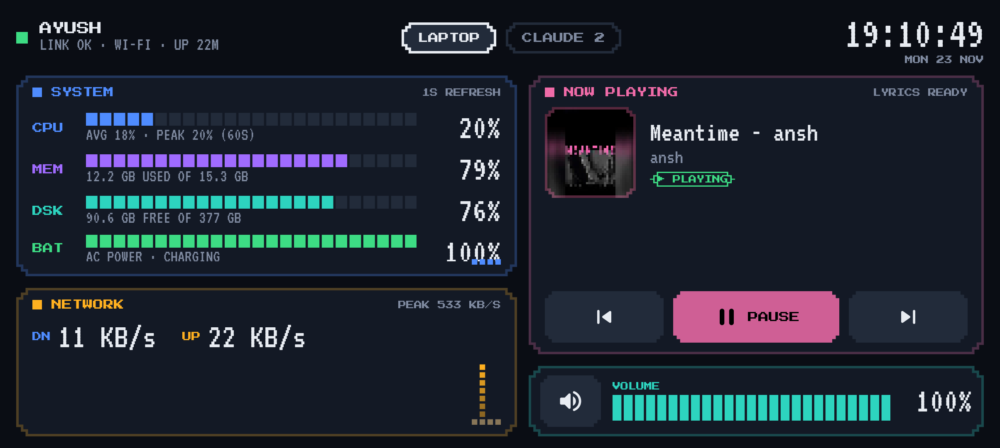
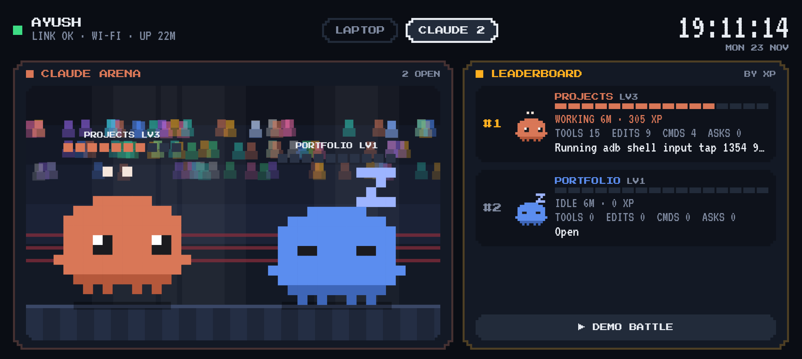
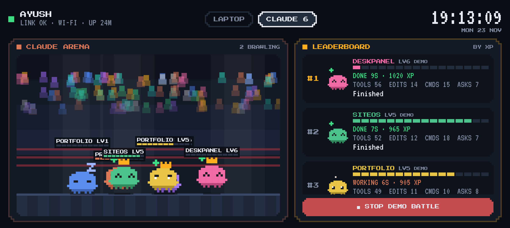
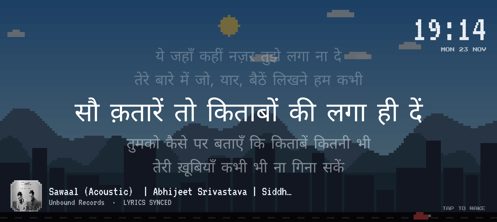

# DeskPanel

Turn an old Android phone into a **pixel-art desk panel** for your Windows laptop.

Live system stats, media and volume controls, synced lyrics, and a **Claude Code arena**: each open Claude Code session is a little pixel mascot, the busy ones fight, and you can **approve or deny Claude's permission requests from your phone**.

Native Android app (Kotlin + Jetpack Compose) plus a small Windows tray agent (.NET). It connects over Wi-Fi with auto-discovery. No browser and no cloud.



| Claude sessions | Demo battle |
|---|---|
|  |  |



## Features

- **Laptop tab**
  - CPU, memory, disk and battery, with a CPU history graph.
  - Live network up/down speeds.
  - Now playing, with album art, prev/play-pause/next and a progress bar. Works with any app that uses Windows media controls (Spotify, browsers, YouTube Music and others).
  - Volume slider and mute.
- **Claude tab**
  - Every open Claude Code session appears as a pixel mascot, with states for working, waiting, needs input, done and idle.
  - Busy sessions pair up and brawl in the arena.
  - Leaderboard with XP and levels, earned from tools used, edits, commands and prompts.
  - A **Demo battle** button spawns fake sessions so you can watch a full fight.
- **Phone approvals**
  - When Claude Code asks for permission, a pixel pop-up appears on the phone with **ALLOW** and **DENY** buttons.
  - If you don't answer within 60 s, the terminal prompt is used as normal.
- **Ambient mode**
  - Starts when music is playing and the screen hasn't been touched for 12 s.
  - Shows synced lyrics from [LRCLIB](https://lrclib.net) when available, otherwise a pixel city time-lapse with a day/night cycle.
  - Tap the screen to get the controls back.
- **Zero-config connect**
  - The phone finds the laptop by UDP broadcast.
  - The first connection asks for approval on the laptop, and the phone is remembered after that.
  - You can also enter the laptop's IP by hand.
- Landscape, immersive, keeps the screen on.

## How it works

```
 Claude Code ──hooks (curl)──▶ ┌──────────────────────┐
                                │  DeskPanel Agent     │  UDP 47810  discovery
 Windows stats / media / vol ─▶ │  (tray app, .NET 10) │◀──────────────▶  Android app
                                │  ws://0.0.0.0:47811  │  WebSocket  /ws  (Compose)
                                └──────────────────────┘
```

- `agent/`: C# tray app.
  - Reads stats with Win32 APIs, volume with Core Audio, and media with WinRT `GlobalSystemMediaTransportControls`.
  - Tracks Claude sessions from hook events and from `~/.claude/sessions/*.json`.
  - Pushes state once a second over a WebSocket.
- `android/`: Kotlin + Jetpack Compose app (minSdk 26).
  - Fonts: VT323 and Press Start 2P, under the SIL Open Font License.

## Setup

### 1. Laptop agent (Windows 10/11)

Requires the [.NET 10 SDK](https://dotnet.microsoft.com/download).

```powershell
cd agent
dotnet publish -c Release -o "$env:LOCALAPPDATA\DeskPanel\app"
& "$env:LOCALAPPDATA\DeskPanel\app\DeskPanelAgent.exe"
```

- A tray icon appears.
- The tray menu has: **Start with Windows**, **Demo battle**, **Forget paired phones**, **Open log**.
- Allow the app through Windows Firewall on **private** networks when asked. It uses TCP 47811 and UDP 47810.

### 2. Android app

Requires JDK 17 and the Android SDK (platform 35, build-tools 35.0.0).

```powershell
cd android
echo "sdk.dir=C\:\\path\\to\\Android\\Sdk" > local.properties
.\gradlew.bat assembleDebug
adb install -r app\build\outputs\apk\debug\app-debug.apk
```

1. Open **DeskPanel** on the phone while it's on the same Wi-Fi as the laptop.
2. Click **Yes** in the pairing prompt that appears on the laptop.

### 3. Claude Code integration (optional)

Merge the `hooks` block from [`hooks/claude-settings-hooks.json`](hooks/claude-settings-hooks.json) into `~/.claude/settings.json`.

- All events are sent asynchronously to the local agent, so they never slow Claude down.
- `PermissionRequest` waits up to 60 s for your answer on the phone.
- The hook endpoint only accepts connections from `127.0.0.1`.

## Privacy

Everything stays on your local network.

- **The only outbound request** is the lyrics lookup to `lrclib.net`, which sends the track title and artist.
- **Pairing tokens** are stored in `%APPDATA%\DeskPanel\phones.json`.

## License

[MIT](LICENSE). The bundled fonts (VT323, Press Start 2P) are under the [SIL Open Font License 1.1](https://openfontlicense.org).
